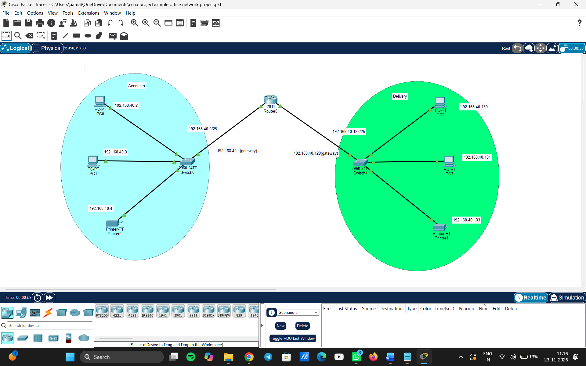
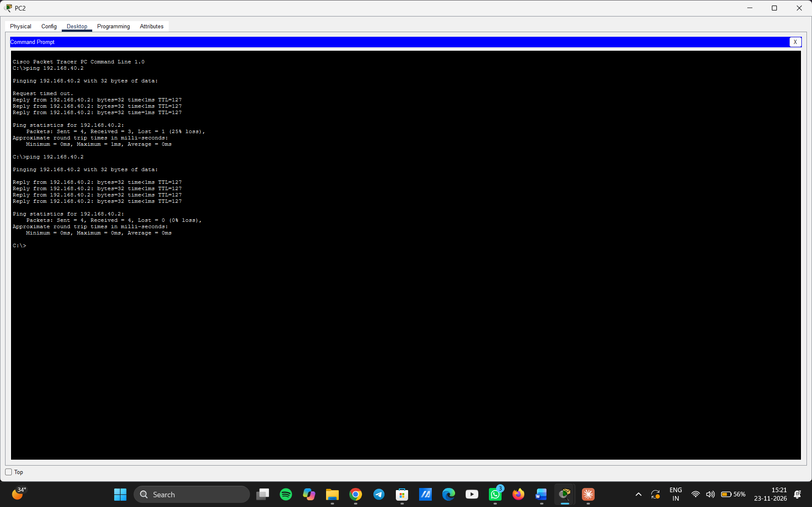
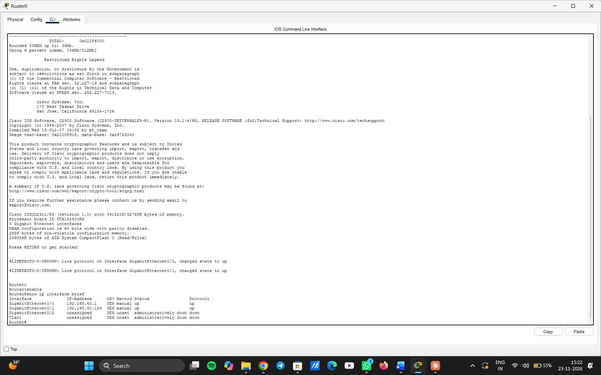
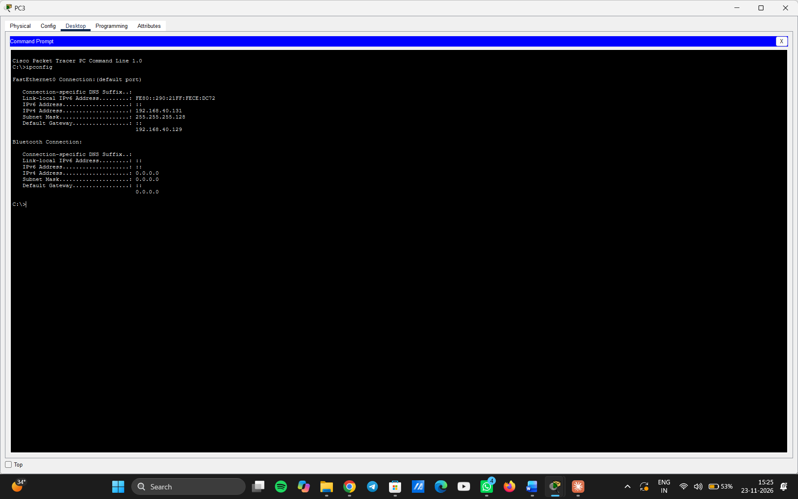
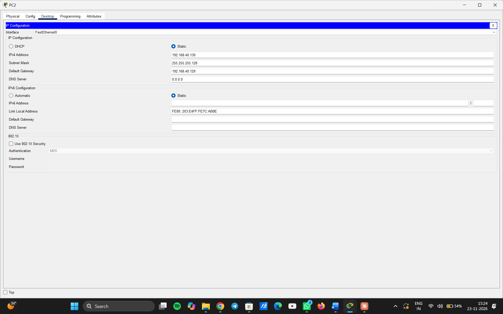

# Small Office Network – Cisco Packet Tracer

## Overview
This project simulates a small office network connecting two departments, Accounts and Delivery, using Cisco Packet Tracer. Both departments communicate through a router using separate IPv4 subnets.

## Objectives
- Connect Accounts and Delivery departments.
- Include at least two PCs in each department.
- Use switches and a router to build the network.
- Configure IP addresses, subnet masks, and default gateways.
- Divide the network into two subnets.
- Test connectivity between departments using ping.

## Network Topology
- 1 Router (Cisco 2911)
- 2 Switches (Cisco 2960)
- 4 PCs (2 Accounts, 2 Delivery)
- 2 Printers (1 per department)

## IP Addressing

### Accounts Department
- Network: 192.168.40.0/25
- Gateway: 192.168.40.1
- PC0: 192.168.40.2
- PC1: 192.168.40.3
- Printer0: 192.168.40.4

### Delivery Department
- Network: 192.168.40.128/25
- Gateway: 192.168.40.129
- PC2: 192.168.40.130
- PC3: 192.168.40.131
- Printer1: 192.168.40.133

### Subnet Mask
- 255.255.255.128

## Network Configuration
- Connected PCs and printers to departmental switches.
- Connected both switches to the router.
- Configured router interfaces with gateway IP addresses.
- Assigned IP addresses, subnet masks, and default gateways to end devices.
- Used Ethernet cables for network connections.

## Connectivity Testing
Tested connectivity between Accounts and Delivery department devices using the ping command.

Example:
```cmd
ping 192.168.40.2
```

Successful ping replies verify communication between devices across different subnets.

## Screenshots

### 1. Network Topology


### 2. Connectivity Test


### 3. Router Interface Status


### 4. PC IP Configuration


### 5. IP Addressing Table


## Tools Used
- Cisco Packet Tracer
- IPv4 Addressing
- Subnetting
- Router Configuration
- ICMP Ping

## Author
Networking practice project focused on network design, IP addressing, subnetting, router configuration, and inter-department connectivity.
